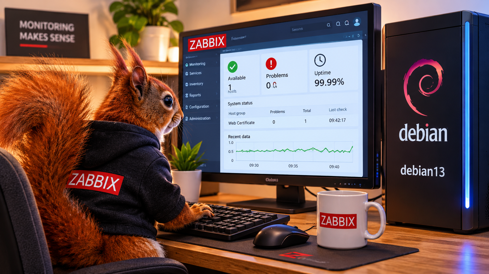

# Samostatná práce: Instalace Zabbixu 8.0 LTS


## Příkazy
```bash
vagrant up
vagrant ssh
systemctl is-active mariadb zabbix-server zabbix-agent2 apache2
vagrant destroy
```

## Adresa webu
http://localhost:8080/zabbix

## Přihlašovací údaje
- **Username:** `Admin`
- **Password:** `zabbix`
